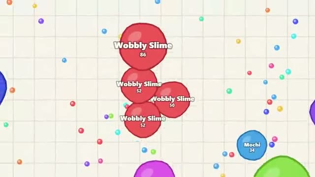

# Blob Feast

Eat smaller blobs. Split to catch them. A multiplayer starter game from [Multiplayer Agent](https://multiplayeragent.com): 2D, drop-in, 2–30 players, with bots that fill empty seats.

## How it plays

Your blob drifts toward the pointer. Eat pellets to grow, and swallow any blob a quarter smaller than you. Split in two to lunge at one, then your pieces merge back after a few seconds.

**Controls:** Mouse or drag to move, Space or the Split button to split.

## Make it yours in the Game Builder

Open the [Game Builder](https://multiplayeragent.com), choose **Start from a starter game** and pick Blob Feast. It opens as version 1 in your studio, ready to play and publish. Then ask for changes, for example:

- Add spiky mines that pop big blobs
- Make it space, with planets eating moons
- Add teams with a team score at the top

## Run it yourself

1. Get a free publishable key (`pk_…`) at [multiplayeragent.com](https://multiplayeragent.com).
2. In `index.html`, put it in place of `pk_REPLACE_ME` in the `MP_CONNECT` block.
3. Open `index.html` in a browser. No build step and no server needed.

Without a key it still runs, offline against bots.

## How it is built

- One `index.html`. The comment at the top of the script maps the code and explains the multiplayer.
- **Leaderboard:** Each player's biggest mass, shown when you get eaten.
- **Bots:** Bots fill the arena until enough people join.
- **Live sync:** Every blob moves for everyone at once; whoever gets eaten tells the eater.
- `?attract` runs it offline with bots only. The preview video is recorded from it.

## License

MIT.
